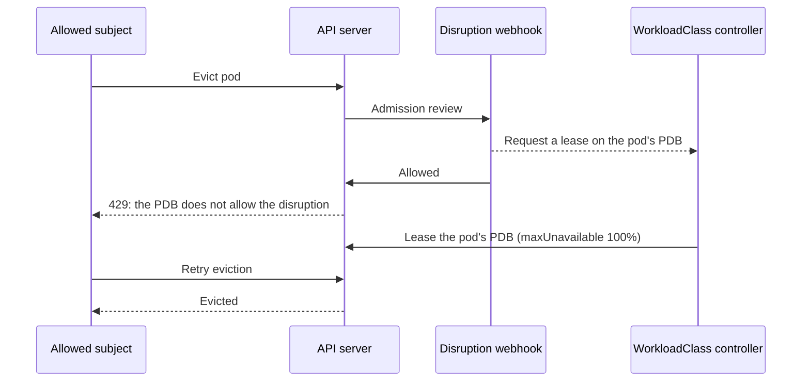
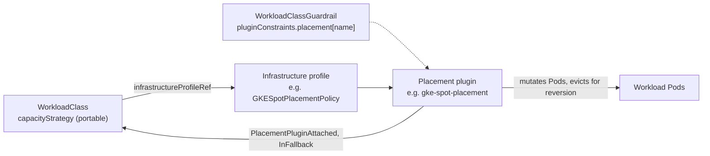

# GKE Workload Class Controller

WorkloadClass establishes a high-level control layer, allowing Platform Engineers to define operational guardrails and Workload Owners to simply declare their desired workload outcomes.

This project implements the GKE Workload Class feature. It allows platform engineers and workload owners to collaborate on managing workload disruptions during maintenance and on placing workloads on Spot VMs (see [Spot Placement](#spot-placement)).

## Disclaimer

This is not an officially supported Google product.
This project is not eligible for the Google Open Source Software Vulnerability Rewards Program.

## Description
The Workload Class Controller manages the lifecycle of disruption policies, ensuring they adhere to organizational guardrails.

A Validating Admission Webhook intercepts eviction requests for pods and enforces temporal constraints (allowed windows) and pod lifecycle protection (minimum run duration). The webhook resolves the applicable `WorkloadClass` for a pod using the following order of precedence:
1. **Namespace-level default**: If a default `WorkloadClass` is labeled on the pod's namespace (`workloads.gke.io/default-class`), it is chosen immediately, overriding any other potential matches.
2. **Pod label selectors**: If no namespace default is defined, the webhook selects the `WorkloadClass` in the pod's namespace that has the highest specificity (matching label selectors) against the pod. If multiple `WorkloadClasses` have the same specificity, the oldest `WorkloadClass` takes precedence.

The controller also expresses each workload's disruption policy as a PodDisruptionBudget for every pod a `WorkloadClass` governs (see [Per-Pod PodDisruptionBudgets](#per-pod-poddisruptionbudgets)).

## Example Usage

**1. Platform Engineer defines a Guardrail**

The platform team creates a `WorkloadClassGuardrail` (Cluster-scoped) to enforce organizational limits:

```yaml
apiVersion: workloads.gke.io/v1
kind: WorkloadClassGuardrail
metadata:
  name: default
spec:
  constraints:
    disruption:
      allowedDisruptionDays:
        - Saturday
        - Sunday
      maxAllowedWindows: 2
      maxNonDisruptionDurationDays: 30
```

**2. Workload Owner defines a WorkloadClass**

The workload owner creates a `WorkloadClass` (Namespace-scoped) to protect their specific pods from disruption during active hours:

```yaml
apiVersion: workloads.gke.io/v1
kind: WorkloadClass
metadata:
  name: critical-batch
  namespace: sample
spec:
  podSelector:
    matchLabels:
      role: batch-processor
  disruptionPolicy:
    allowedDisruptionWindows:
      - name: "weekend-maintenance"
        daysOfWeek:
          - Saturday
          - Sunday
        startTime: "00:00"
        endTime: "04:00"
        timeZone: "America/Toronto"
    minInitialRunDurationDays: 2
    maxNonDisruptionDurationDays: 1
    allowedDisruptionsOutsideOfWindow:
      - kind: ServiceAccount
        name: vpa-updater
        namespace: kube-system
      - kind: ServiceAccount
        name: cluster-autoscaler
        namespace: kube-system
```

**3. (Optional) Assign a Default WorkloadClass to a Namespace**

You can assign a default `WorkloadClass` to a namespace using a label. This namespace-level default takes precedence over all individual pod label selectors in that namespace: if a default is defined, it will be applied to all pods in the namespace, ignoring any other matching `WorkloadClass` selectors.

```yaml
apiVersion: v1
kind: Namespace
metadata:
  name: sample
  labels:
    workloads.gke.io/default-class: critical-batch
```

**4. Testing the Capabilities**

**A. Testing Disruption Webhooks**

You can deploy a dummy deployment that matches the `WorkloadClass` selector and attempt to disrupt its pods. If the current time is outside the `weekend-maintenance` window, the webhook will intercept and reject the disruption:

```sh
# 1. Apply the CRDs, dummy deployment, and sample namespace
kubectl apply -k config/samples/

# 2. Attempt to evict the deployment's pod outside the maintenance window using the Eviction API
kubectl proxy &
PROXY_PID=$!
sleep 2

POD_NAME=$(kubectl get pods -n sample -l role=batch-processor -o jsonpath='{.items[0].metadata.name}')
curl -s -X POST "http://127.0.0.1:8001/api/v1/namespaces/sample/pods/$POD_NAME/eviction" \
  -H "Content-Type: application/json" \
  -d "{\"apiVersion\": \"policy/v1\", \"kind\": \"Eviction\", \"metadata\": {\"name\": \"$POD_NAME\", \"namespace\": \"sample\"}}"

kill $PROXY_PID
```
*Expected Output (if outside window):*
```json
{
  "kind": "Status",
  "apiVersion": "v1",
  "metadata": {},
  "status": "Failure",
  "message": "admission webhook \"vpoddisruption.gke.io\" denied the request: Eviction blocked: currently outside of allowed disruption windows for WorkloadClass critical-batch",
  "reason": "Forbidden",
  "code": 403
}
```

**B. Testing Guardrail Validation**

You can attempt to update the `WorkloadClass` with an invalid policy that violates the `WorkloadClassGuardrail` (e.g., setting 32 maxNonDisruptionDurationDays when the guardrail only allows 30). The validation will fail and the WorkloadClass Status will be updated:

```sh
# Attempt to apply a WorkloadClass with too many windows or invalid duration
kubectl apply -f config/samples/workloads_v1_workloadclass.yaml
```
*Expected Status (if invalid):*
```sh
# Describe the WorkloadClass
kubectl describe workloadclass critical-workload -n demo
```
```
Status:
  Conditions:
    Last Transition Time:  2026-06-05T14:59:29Z
    Message:               maxNonDisruptionDurationDays 32 exceeds guardrail limit 30
    Reason:                ValidationFailed
    Status:                False
    Type:                  Validated
  Maintenance Readiness:   NotReady
Events:                    <none>
```

**C. Testing Selector Conflict Validation**

If you create multiple `WorkloadClass` resources with the same `podSelector` in the same namespace, the controller will detect the conflict and emit a warning Event:

```sh
# Apply a duplicate WorkloadClass in the same namespace with the same selector
kubectl apply -f config/samples/workloads_v1_workloadclass_duplicate.yaml
```

*Expected Events:*
```sh
# Describe the duplicate WorkloadClass
kubectl describe workloadclass critical-batch-duplicate -n sample
```
```
Events:
  Type     Reason            Age   From                       Message
  ----     ------            ----  ----                       -------
  Warning  ValidationFailed  10s   workloadclass-controller   the following WorkloadClasses have the same PodSelector as critical-batch-duplicate: critical-batch
```

**D. Evicting as an Allowed Subject Outside the Window**

The sample `WorkloadClass` allows `kube-system/cluster-autoscaler` to disrupt pods outside of its windows. Evicting as that service account outside the window takes two attempts: the first is rejected by the pod's closed PDB while the controller leases it, and a retry succeeds (see [Leasing for Allowed Subjects](#leasing-for-allowed-subjects)):

```sh
POD_NAME=$(kubectl get pods -n sample -l role=batch-processor -o jsonpath='{.items[0].metadata.name}')
cat > /tmp/eviction.json <<EOF
{"apiVersion": "policy/v1", "kind": "Eviction", "metadata": {"name": "$POD_NAME", "namespace": "sample"}}
EOF

# 1. The first attempt is admitted by the webhook but rejected by the pod's PDB
kubectl create --raw "/api/v1/namespaces/sample/pods/$POD_NAME/eviction" -f /tmp/eviction.json \
  --as=system:serviceaccount:kube-system:cluster-autoscaler
# Error from server (TooManyRequests): Cannot evict pod as it would violate the pod's disruption budget.

# 2. After a few seconds, the controller has leased the pod's PDB to the cluster autoscaler
kubectl get pdb "workload-$POD_NAME" -n sample \
  -o jsonpath='{.spec.maxUnavailable} {.metadata.annotations.workloads\.gke\.io/bypass-owner}'
# 100% system:serviceaccount:kube-system:cluster-autoscaler

# 3. The retry succeeds
kubectl create --raw "/api/v1/namespaces/sample/pods/$POD_NAME/eviction" -f /tmp/eviction.json \
  --as=system:serviceaccount:kube-system:cluster-autoscaler
```

> **NOTE:** Impersonating the service account with `--as` requires impersonation permissions, and the service account needs permission to create `pods/eviction`.

## Per-Pod PodDisruptionBudgets

In addition to the webhook, the controller expresses each workload's disruption policy as standard PodDisruptionBudgets (PDBs), which Kubernetes components such as the cluster autoscaler, `kubectl drain`, and node upgrades already respect when planning and performing disruptions. It creates a PDB for each pod a `WorkloadClass` governs.

### Which Pods Get a PDB

A pod is governed by its best-match `WorkloadClass`, using the same precedence as the webhook: the namespace default if one is set, otherwise the most specific matching `podSelector` (the oldest wins ties). The controller creates a PDB for every governed pod, except:

- **Pods already covered by a user-created PDB.** If any PDB not managed by a `WorkloadClass` selects a pod, the user's PDB takes precedence and the controller doesn't create one. If a user creates such a PDB later, the controller deletes its PDB for the pod, and recreates it if the user's PDB is removed.
- **Terminating or completed pods.**

> **NOTE:** A `WorkloadClass` without a `podSelector` only governs pods when it is the namespace default.

### PDB Spec

Each PDB is named `workload-<pod name>`. The controller labels the pod with `workloads.gke.io/pod-uid: <pod UID>`, and the PDB selects only that label, so it covers exactly one pod and never a later pod that reuses the same name. The PDB uses `unhealthyPodEvictionPolicy: IfHealthyBudget`, and its `maxUnavailable` follows the `WorkloadClass`:

| `WorkloadClass` state | `maxUnavailable` |
| --- | --- |
| `Validated=True` and `MaintenanceReadiness: NotReady` (outside a window, or a pod hasn't met `minInitialRunDurationDays`) | `0`: evictions are blocked. |
| `MaintenanceReadiness: Ready` or `Overdue` | `100%`: evictions are allowed. |
| `Validated=False` (fails guardrail validation) | `100%`: the controller opens existing PDBs instead of deleting them, and doesn't create new ones. |

```sh
kubectl get pdb -n sample
```
```
NAME                                        MIN AVAILABLE   MAX UNAVAILABLE   ALLOWED DISRUPTIONS   AGE
workload-test-deployment-5f8c7d9b6c-x2k4p   N/A             0                 0                     2m
```

> **NOTE:** The controller only creates PDBs for a `WorkloadClass` that passed validation against at least one `WorkloadClassGuardrail`.

### Ownership and Cleanup

Each PDB is owned by its pod's `WorkloadClass` through a controller owner reference, so deleting the `WorkloadClass` deletes its PDBs. The controller also deletes a pod's PDB when the pod is deleted, starts terminating, or reaches a terminal phase, when a user-created PDB starts covering it, or when no `WorkloadClass` governs it anymore.

When a pod's best-match `WorkloadClass` changes, for example because a namespace default is set or a more specific `WorkloadClass` is created, the new `WorkloadClass` takes ownership of the existing PDB rather than deleting and recreating it. The controller never modifies a user-created PDB, even one that happens to be named `workload-<pod name>`.

### Leasing for Allowed Subjects

Subjects listed in `allowedDisruptionsOutsideOfWindow` (such as the cluster autoscaler or VPA) are admitted by the webhook regardless of disruption windows and `minInitialRunDurationDays`. When their eviction targets a pod whose PDB is closed, the pod's PDB is temporarily opened for them with a **lease**:



1. The webhook admits the eviction and asks the controller to lease the pod's PDB. The webhook itself never modifies PDBs, which keeps admission fast.
2. The closed PDB rejects this first attempt with `429 TooManyRequests`. Eviction clients such as the cluster autoscaler and `kubectl drain` retry automatically.
3. The controller sets the PDB's `maxUnavailable` to `100%` and records the lease in two annotations: `workloads.gke.io/bypass-owner` (the subject's identity, e.g. `system:serviceaccount:kube-system:cluster-autoscaler`) and `workloads.gke.io/bypass-expiration`.
4. The subject's retry succeeds.

Leases are per pod, so several pods of the same workload can be evicted at the same time, for example when the cluster autoscaler drains a node. While a lease is active, eviction requests for that pod from other allowed subjects are denied. A lease lasts for the pod's termination grace period (30 seconds by default). Once it expires, the controller re-syncs the PDB with the `WorkloadClass`, closing it again if the workload is still outside its disruption window.

> **NOTE:** Lease requests are passed from the webhook to the controller in memory, so the controller manager must run as a single replica (the default).

## Spot Placement

WorkloadClass can also place a workload's Pods on Spot (preemptible) capacity, fall back to On-Demand capacity during a Spot stockout, and move Pods back to Spot once capacity returns. Spot placement is built as a **plugin architecture**: the core WorkloadClass API carries only cloud-agnostic intent, and provider-specific behavior lives in placement plugins. This repository ships the first plugin, `gke-spot-placement`, for [GKE Spot VMs](https://cloud.google.com/kubernetes-engine/docs/concepts/spot-vms).

### Plugin Architecture

**Provider-agnostic intent.** A workload owner describes *what* they want in `WorkloadClass.spec.capacityStrategy`: whether to use Spot, what share of Pods should run on Spot, and whether to wait or fall back to On-Demand during a stockout. None of these fields mention machine types, node labels, or a cloud provider. The same `capacityStrategy` works whether the cluster runs on GKE, another cloud, or on-premises.

**Provider-specific profiles.** *How* to realize that intent on a given platform lives in a separate infrastructure profile resource defined and owned by a plugin, such as `GKESpotPlacementPolicy` for GKE. The `WorkloadClass` points at the profile with `spec.infrastructureProfileRef` (`group`, `kind`, `name`). The `kind` selects the plugin, and the plugin owns everything provider-specific: node labels, compute classes, machine families, capacity signals, and reversion mechanics. Platform teams can publish a few standard profiles and let many WorkloadClasses reference them. Moving a workload to another provider means changing only the `infrastructureProfileRef`, not the `capacityStrategy`.



**Plugin contract.** The core WorkloadClass controller has no provider-specific logic: no node labels, capacity signals, or evictions. It coordinates with plugins through `WorkloadClass.status.conditions`, and each controller writes only the conditions it owns:

| Step | Core WorkloadClass controller | Placement plugin |
| --- | --- | --- |
| Attach | Sees `infrastructureProfileRef`, sets `PlacementPluginAttached=False` (`PluginPending`), and holds `Validated=False` until a plugin attaches. | Resolves the referenced profile, validates it against its guardrail constraints, and sets `PlacementPluginAttached=True` (`ProfileResolved`) or `False` (`PluginResolutionFailed`). |
| Place Pods | Not involved. | Its webhook mutates new Pods of WorkloadClasses that reference its profile kind, and ignores the rest. |
| Runtime | Keeps managing disruption windows, maintenance readiness, and PDBs. | Watches provider capacity signals, reports `InFallback`, and runs reversion. |
| Guardrails | Owns `spec.constraints`. Only checks that each `pluginConstraints.placement` entry has a name and that its `parameters` are a JSON object. | Defines and validates the schema of `parameters` in the entry with its name, e.g. `gke-spot-placement`. |

If a WorkloadClass references a profile kind for which no plugin is installed, or a profile that doesn't exist, it stays in `PluginPending` or `PluginResolutionFailed`. Its Pods are then admitted unchanged rather than placed without the profile's rules.

> **NOTE:** Because `capacityStrategy` is portable, the core controller validates it against the portable limits in the `gke-spot-placement` guardrail entry: `enforcementMode`, `minSpotRatio`, and `allowFallbackToOnDemand`.

### The `gke-spot-placement` Plugin

The GKE plugin runs in the same controller manager as the core controller. It is responsible for WorkloadClasses that have a `capacityStrategy` and either reference a `GKESpotPlacementPolicy` or have no `infrastructureProfileRef` at all (in that case GKE defaults apply). Its resources:

| Resource | Scope | Owner | Purpose |
| --- | --- | --- | --- |
| `WorkloadClass` (`spec.capacityStrategy`) | Namespaced | Workload Owner | Portable intent: Spot vs. On-Demand, target Spot percentage, and what to do during a stockout. |
| `GKESpotPlacementPolicy` | Cluster | Platform Engineer | GKE infrastructure profile: Custom Compute Class, allowed fallback machine families, and reversion behavior. One policy can be shared by many WorkloadClasses. |
| `WorkloadClassGuardrail` (`spec.pluginConstraints`) | Cluster | Platform Engineer | Limits on what WorkloadClasses and policies may request, in the `gke-spot-placement` entry. |

Its components:

1. **`GKESpotPlacementPolicyReconciler`** validates each `GKESpotPlacementPolicy` against the guardrails and attaches it to the WorkloadClasses that reference it (`PlacementPluginAttached`).
2. A **mutating Pod webhook** (`/mutate-pod-placement`) runs when a Pod is created. It finds the Pod's best-matching WorkloadClass and adds Spot or On-Demand scheduling constraints. It only acts once the WorkloadClass is `Validated=True` (and `PlacementPluginAttached=True` when it references a policy). Otherwise it admits the Pod unchanged.
3. **`GKESpotPlacementReconciler`** watches the workload's Pods and the cluster autoscaler status (`kube-system/cluster-autoscaler-status`). It sets the `InFallback` condition when Spot-targeted Pods are running on On-Demand nodes, and runs reversion when Spot capacity returns.

### 1. Platform Engineer: Add Spot constraints to a Guardrail

Spot constraints go under `spec.pluginConstraints.placement`, in an entry named `gke-spot-placement`:

```yaml
apiVersion: workloads.gke.io/v1
kind: WorkloadClassGuardrail
metadata:
  name: default
spec:
  constraints:
    disruption:
      allowedDisruptionDays:
        - Saturday
        - Sunday
      maxAllowedWindows: 2
      maxNonDisruptionDurationDays: 30
  pluginConstraints:
    placement:
      - name: gke-spot-placement
        parameters:
          enforcementMode: Allowed      # Allowed | Required | Forbidden
          minSpotRatio: "50%"
          fallback:
            allowFallbackToOnDemand: true
            maxFallbackRatio: "25%"     # or an absolute Pod count, e.g. 5
          reversion:
            requiredReversionAction: Active
            maxFallbackDuration: 12h
```

| Parameter | Effect (if omitted: no restriction) |
| --- | --- |
| `enforcementMode` | `Required`: WorkloadClasses must set a `capacityStrategy` with `type: Spot` and a non-zero `spotRatio`. `Forbidden`: WorkloadClasses can't use `type: Spot`, and GKESpotPlacementPolicies fail validation. `Allowed` (default): no restriction. |
| `minSpotRatio` | Minimum `spotRatio` a Spot WorkloadClass may set. |
| `fallback.allowFallbackToOnDemand` | `false` rejects WorkloadClasses with `action: FallbackToOnDemand`. |
| `fallback.maxFallbackRatio` | Caps how many of a WorkloadClass's Pods may run on On-Demand fallback at the same time, as a percentage or a Pod count. When a stockout hits the cap, new Pods are placed on Spot only and stay `Pending` (the WorkloadClass gets a `FallbackBudgetExhausted` event). `0` / `"0%"` disallows fallback. |
| `reversion.requiredReversionAction` | GKESpotPlacementPolicies must use this reversion action. |
| `reversion.maxFallbackDuration` | Upper bound on how long any Pod may stay on fallback. Once a Pod passes it and Spot capacity is available, the Pod is evicted regardless of reversion action or `spotRatio`. Policies with reversion `None`, or with `minDurationOnFallback` above this value, fail validation. |

When several guardrails exist, the most restrictive value wins. The guardrail webhook rejects invalid or contradictory parameters, such as unknown fields, `enforcementMode: Forbidden` with a non-zero `minSpotRatio`, or `requiredReversionAction: None` with `maxFallbackDuration`.

### 2. Platform Engineer: Define a GKESpotPlacementPolicy

```yaml
apiVersion: workloads.gke.io/v1
kind: GKESpotPlacementPolicy
metadata:
  name: gke-t2d-spot            # cluster-scoped
spec:
  customComputeClass: t2d-standard          # optional
  fallbackAllowedMachineFamilies: ["n2d", "e2"]  # optional
  reversion:
    action: Active              # Active | Lazy | None (default)
    minDurationOnFallback: 15m  # optional, Active only
```

| Field | Effect |
| --- | --- |
| `customComputeClass` | Adds the `cloud.google.com/compute-class` nodeSelector to Spot-targeted Pods, unless the Pod already selects a compute class. |
| `fallbackAllowedMachineFamilies` | During fallback, restricts On-Demand nodes to these `cloud.google.com/machine-family` values. Spot nodes of any family remain allowed. |
| `reversion.action` | What happens to fallback Pods once Spot capacity returns (see [Fallback and Reversion](#fallback-and-reversion)). Default: `None`. |
| `reversion.minDurationOnFallback` | Minimum time a Pod must run on fallback before Active reversion evicts it. When omitted, a **5m** floor applies so a wrong capacity signal can't evict the same Pod in a loop. Set `0s` to opt out. Values above `0s` require `action: Active`. |

Check the policy with `kubectl get gkespotpolicy`. The `Validated` column shows whether the policy satisfies the guardrails.

### 3. Workload Owner: Add a Capacity Strategy to a WorkloadClass

```yaml
apiVersion: workloads.gke.io/v1
kind: WorkloadClass
metadata:
  name: checkout-service
  namespace: sample
spec:
  podSelector:
    matchLabels:
      app: checkout-service
  disruptionPolicy:
    allowedDisruptionWindows:
      - name: "weekend-maintenance"
        daysOfWeek:
          - Saturday
          - Sunday
        startTime: "02:00"
        endTime: "06:00"
        timeZone: "America/New_York"
    maxNonDisruptionDurationDays: 7
  capacityStrategy:
    type: Spot                  # Spot (default) | OnDemand
    spotRatio: "80%"            # default "100%"
    action: FallbackToOnDemand  # Fail (default) | FallbackToOnDemand
  infrastructureProfileRef:
    group: workloads.gke.io     # optional, defaults to workloads.gke.io
    kind: GKESpotPlacementPolicy
    name: gke-t2d-spot
```

| Field | Effect |
| --- | --- |
| `capacityStrategy.type` | `Spot` targets Spot capacity. `OnDemand` places every Pod on On-Demand nodes, letting a workload opt out of Spot. |
| `capacityStrategy.spotRatio` | Target share of Pods on Spot (integer percentage). New Pods go to Spot until the Spot share reaches the target, and the rest go On-Demand. For example, at `80%`, 4 of 5 Pods go to Spot. |
| `capacityStrategy.action` | `Fail`: Spot-targeted Pods can only run on Spot nodes and stay `Pending` during a stockout. `FallbackToOnDemand`: Spot-targeted Pods prefer Spot but can schedule on On-Demand nodes when Spot is unavailable. |
| `infrastructureProfileRef` | Optional. References a `GKESpotPlacementPolicy`. Without it, the `capacityStrategy` is applied with GKE defaults: no compute class, no machine-family restriction, and Lazy reversion. A reference to a different profile kind is left to that profile's plugin. |

Opting a single workload out of Spot (rejected if a guardrail sets `enforcementMode: Required`):

```yaml
apiVersion: workloads.gke.io/v1
kind: WorkloadClass
metadata:
  name: payments-ledger
  namespace: sample
spec:
  podSelector:
    matchLabels:
      app: payments-ledger
  capacityStrategy:
    type: OnDemand
```

### Pod Mutations

For each new Pod, the webhook picks a target and adds:

| Target | Mutation |
| --- | --- |
| Spot, `action: Fail` | Toleration `cloud.google.com/gke-spot=true:NoSchedule`, nodeSelector `cloud.google.com/gke-spot: "true"`, and the policy's compute class (if set). |
| Spot, `action: FallbackToOnDemand` | The Spot toleration, a preferred node affinity (weight 100) for `cloud.google.com/gke-spot In [true]`, and the policy's compute class (if set). If `fallbackAllowedMachineFamilies` is set, a required node affinity that allows Spot nodes OR On-Demand nodes of those families. |
| On-Demand | Required node affinity `cloud.google.com/gke-spot DoesNotExist`, with any Spot nodeSelector and toleration removed. |

The Pod's existing required node affinity is preserved: the webhook ANDs its terms with the existing ones rather than replacing them.

### Status and Readiness

```sh
kubectl get workloadclass -n sample
```
```
NAME               MAINTENANCE   CAPACITY   SPOTRATIO   PROFILE        VALIDATED   AGE
checkout-service   NotReady      Spot       80%         gke-t2d-spot   True        5m
```

| Condition | Meaning |
| --- | --- |
| `PlacementPluginAttached` | `True` (`ProfileResolved`) once the referenced policy exists and passes the guardrails. `False` with `PluginPending` (no plugin controller has attached it yet) or `PluginResolutionFailed` (policy not found or invalid). Not set when there is no `infrastructureProfileRef`. |
| `Validated` | `True` when the WorkloadClass passes all guardrails and, if it references a policy, the policy is attached. Pods are only mutated while this is `True`. |
| `InFallback` | `True` (`FallbackActive`) while any Spot-targeted Pod is running on an On-Demand node. Pods placed On-Demand on purpose to meet `spotRatio` don't count. |

If the WorkloadClass isn't ready, `kubectl describe workloadclass checkout-service -n sample` shows the guardrail violation or policy problem in the condition message.

### Fallback and Reversion

When `action: FallbackToOnDemand` is set and Spot capacity runs out, Spot-targeted Pods land on On-Demand nodes and the WorkloadClass reports `InFallback=True`. Once Spot capacity is available again (a Spot node group in `cluster-autoscaler-status` is healthy and not in backoff), the policy's `reversion.action` decides what happens to those fallback Pods:

| Action | Behavior |
| --- | --- |
| `Active` | Evicts fallback Pods (oldest first) that have been on fallback for at least `minDurationOnFallback`, until the Spot share reaches `spotRatio` again. Their controllers recreate them, and the webhook targets Spot. |
| `Lazy` | Leaves running fallback Pods alone. New or recreated Pods target Spot again. |
| `None` (default) | Once a workload falls back, all new and recreated Pods are placed On-Demand. Guardrail `maxFallbackRatio` doesn't apply, so the workload isn't left split between On-Demand Pods and `Pending` Spot Pods. |

Reversion evictions go through the Eviction API, so they respect PodDisruptionBudgets and the WorkloadClass's `disruptionPolicy`. Outside an allowed disruption window, evictions wait for the next window. Pods without a controller owner are never evicted. A guardrail `maxFallbackDuration` applies under any action: past that limit, a fallback Pod is evicted even if the `spotRatio` target is already met.

### Try It Out

After applying the guardrail, policy, and WorkloadClass above, create a Deployment whose Pods match the selector and inspect the scheduling constraints the webhook added:

```sh
kubectl create deployment checkout-service -n sample --image=registry.k8s.io/pause:3.9 --replicas=5
kubectl get pods -n sample -l app=checkout-service \
  -o custom-columns='NAME:.metadata.name,NODE:.spec.nodeName,SELECTOR:.spec.nodeSelector,TOLERATIONS:.spec.tolerations[*].key'
kubectl get pod -n sample -l app=checkout-service -o jsonpath='{.items[0].spec.affinity.nodeAffinity}'
```

> **NOTE:** `kubectl create deployment` labels the Pods `app=checkout-service`, which matches the WorkloadClass selector. Pods in `kube-system`, `cert-manager`, and `workload-class-system` are never mutated. The cluster needs a Spot node pool (or a compute class that provisions Spot nodes) for Spot-targeted Pods to schedule.


## Getting Started

### Prerequisites
- go version v1.24.6+
- docker version 17.03+.
- kubectl version v1.11.3+.
- Access to a Kubernetes v1.11.3+ cluster.
- cert-manager version v1.x (required for webhooks).

### For Developers: Deploy using Make

> **NOTE:** Our GitHub Actions workflow automatically builds and pushes the controller image to `ghcr.io/gke-labs/workload-class` on every push to `main`. You only need to build locally if you are testing uncommitted changes.

**Install the CRDs into the cluster:**

```sh
make install
```

**Deploy the Manager to the cluster using the public image:**

```sh
make deploy IMG=ghcr.io/gke-labs/workload-class:latest
```

*(If you are testing local code changes, you can optionally build and push your own image first using `make docker-build docker-push IMG=<your-registry>/workload-class:dev` and then deploy with that `IMG`.)*

> **NOTE**: If you encounter RBAC errors, you may need to grant yourself cluster-admin
privileges or be logged in as admin.

**Create instances of your solution**
You can apply the samples (examples) from the config/sample:

```sh
kubectl apply -k config/samples/
```

>**NOTE**: Ensure that the samples have default values to test it out.

### For Developers: Uninstall using Make
**Delete the instances (CRs) from the cluster:**

```sh
kubectl delete -k config/samples/
```

**Delete the APIs(CRDs) from the cluster:**

```sh
make uninstall
```

**UnDeploy the controller from the cluster:**

```sh
make undeploy
```

## For Users: Deploying to GKE with `kubectl`

This section guides you through creating a GKE cluster and deploying the Workload Class controller and resources using `gcloud` and `kubectl` directly, using our pre-built public container image.

### 1. Create a GKE Cluster

Create a GKE Standard cluster to run your workloads:

```sh
gcloud container clusters create workload-class-demo \
    --region us-central1 \
    --num-nodes 3 \
    --project YOUR_PROJECT_ID
```

After creation, ensure your `kubectl` is configured to connect to the cluster:
```sh
gcloud container clusters get-credentials workload-class-demo \
    --region us-central1 \
    --project YOUR_PROJECT_ID
```
*(Note: Adjust the region and project ID as necessary.)*

### 2. Install cert-manager

The controller's webhooks require `cert-manager` to provision certificates. Install it on your cluster:

```sh
kubectl apply -f https://github.com/cert-manager/cert-manager/releases/download/v1.20.2/cert-manager.yaml
```

Wait for the cert-manager pods to be up and running:
```sh
kubectl wait --for=condition=ready pod -l app.kubernetes.io/instance=cert-manager -n cert-manager --timeout=300s
```

### 3. Deploy the Controller

Deploy the controller directly from the official release bundle. This configuration is already set to automatically pull the latest image from our [public GitHub Container Registry package](https://github.com/gke-labs/workload-class/pkgs/container/workload-class).

Apply the configuration to your cluster:

```sh
kubectl apply -f https://raw.githubusercontent.com/gke-labs/workload-class/main/dist/install.yaml
```

### 4. Create the Guardrail and Workload Class

Once the controller is running, you can create the guardrail and workload class resources.

Apply the sample guardrail:
```sh
kubectl apply -f https://raw.githubusercontent.com/gke-labs/workload-class/main/config/samples/workloads_v1_workloadclassguardrail.yaml
```

Apply a sample namespace:
```sh
kubectl apply -f https://raw.githubusercontent.com/gke-labs/workload-class/main/config/samples/sample_namespace.yaml
```

Apply the sample workload class:
```sh
kubectl apply -f https://raw.githubusercontent.com/gke-labs/workload-class/main/config/samples/workloads_v1_workloadclass.yaml
```

Alternatively, you can apply all samples (including the test namespace and dummy deployment) directly via Kustomize:
```sh
kubectl apply -k https://github.com/gke-labs/workload-class/config/samples\?ref\=main
```

## Project Distribution

Following the options to release and provide this solution to the users.

### By providing a bundle with all YAML files

**1. Build the installer for the image built and published in the registry:**

```sh
make build-installer IMG=ghcr.io/gke-labs/workload-class:latest
```

**NOTE:** The makefile target mentioned above generates an `install.yaml`
file in the dist directory. This file contains all the resources built
with Kustomize, which are necessary to install this project without its
dependencies.

**2. Using the installer**

Users can just run `kubectl apply -f <URL for YAML BUNDLE>` to install
the project, i.e.:

```sh
kubectl apply -f https://raw.githubusercontent.com/gke-labs/workload-class/main/dist/install.yaml
```

### By providing a Helm Chart

1. Build the chart using the optional helm plugin

```sh
kubebuilder edit --plugins=helm/v2-alpha
```

2. See that a chart was generated under 'dist/chart', and users
can obtain this solution from there.

**NOTE:** If you change the project, you need to update the Helm Chart
using the same command above to sync the latest changes. Furthermore,
if you create webhooks, you need to use the above command with
the '--force' flag and manually ensure that any custom configuration
previously added to 'dist/chart/values.yaml' or 'dist/chart/manager/manager.yaml'
is manually re-applied afterwards.

## Contributing

We welcome contributions! Please see [docs/contributing.md](docs/contributing.md) for more information.
We follow [Google's Open Source Community Guidelines](https://opensource.google.com/conduct/).

**NOTE:** Run `make help` for more information on all potential `make` targets. More information can be found via the [Kubebuilder Documentation](https://book.kubebuilder.io/introduction.html).

## License

This project is licensed under the [Apache 2.0 License](LICENSE).

